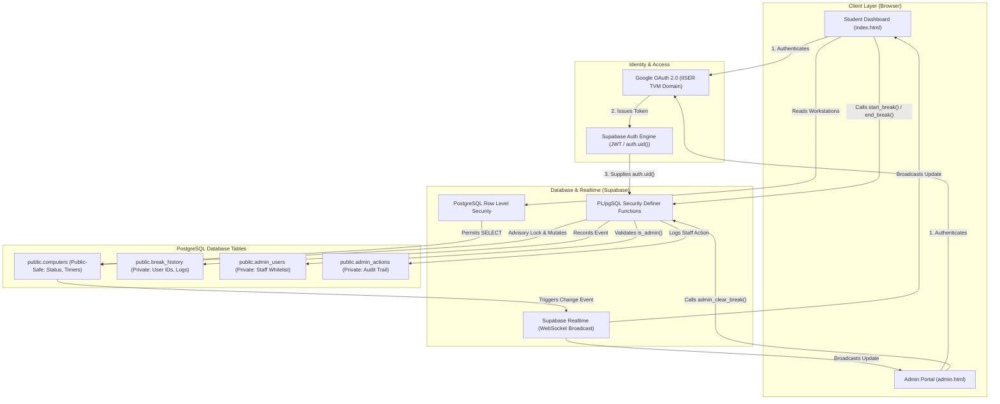

# CCC Computer Lab Break-Timer System

*An initiative of the Student Welfare Council (SWC), Indian Institute of Science Education and Research Thiruvananthapuram (IISER TVM).*

[](https://github.com/SWC-IISERTVM/ccc-seat/actions/workflows/pages.yml)
[](LICENSE)
[](#security-and-privacy)

---

## Quick Links

- **Student Dashboard (Live):** [https://swc-iisertvm.github.io/ccc-seat/](https://swc-iisertvm.github.io/ccc-seat/)
- **Staff Administration Portal (Live):** [https://swc-iisertvm.github.io/ccc-seat/admin.html](https://swc-iisertvm.github.io/ccc-seat/admin.html)
- **Source Repository:** [https://github.com/SWC-IISERTVM/ccc-seat](https://github.com/SWC-IISERTVM/ccc-seat)

---

## Table of Contents

1. [Project Title and Introduction](#1-project-title-and-introduction)
2. [Problem Statement](#2-problem-statement)
3. [Project Objectives](#3-project-objectives)
4. [How the System Works](#4-how-the-system-works)
5. [Rules and Usage Guidelines](#5-rules-and-usage-guidelines)
6. [Features](#6-features)
7. [Admin Portal](#7-admin-portal)
8. [Technology Stack](#8-technology-stack)
9. [Project Architecture](#9-project-architecture)
10. [Installation and Local Development](#10-installation-and-local-development)
11. [Environment Configuration](#11-environment-configuration)
12. [Deployment](#12-deployment)
13. [Security and Privacy](#13-security-and-privacy)
14. [Limitations](#14-limitations)
15. [Future Improvements](#15-future-improvements)
16. [Acknowledgements and Credits](#16-acknowledgements-and-credits)

---

## 1. Project Title and Introduction

The **CCC Computer Lab Break-Timer System** is a lightweight, privacy-preserving web platform engineered to promote fair and transparent access to institutional computing facilities across IISER Thiruvananthapuram. Developed as an initiative of the **Student Welfare Council (SWC)**, the platform serves two major campus facilities:
- **Central Computing Center (CCC):** 151 workstations
- **Interdisciplinary Computer Center (IDC):** 100 workstations

The system provides students with an objective, synchronized 15-minute countdown timer when temporarily stepping away from a computer for personal necessities (such as restroom breaks, meals, or brief discussions). By making break durations publicly visible and enforcing community-agreed operational rules, the platform eliminates ambiguity, reduces disputes, and prevents prolonged informal reservations of shared workstations.

---

## 2. Problem Statement

In institutional academic environments, computing labs experience acute demand surges during examination weeks, programming laboratory courses, computational research runs, and assignment submission deadlines. Under high-occupancy conditions, a recurring point of friction arises: **informal, prolonged desk reservation via unattended belongings**.

Students frequently leave notebooks, bags, water bottles, lab coats, or writing materials on computer desks to hold a workstation while remaining physically absent for extended periods—sometimes lasting hours. This practice creates:
- **Artificial scarcity:** Desks appear occupied despite no active computing work occurring.
- **Interpersonal friction:** Students needing computers hesitate to move unattended belongings without clear authority or knowledge of when the prior occupant left.
- **Administrative overhead:** Lab staff and Student Welfare Council representatives are repeatedly drawn into disputes regarding seat entitlement and missing or moved personal items.

The CCC Computer Lab Break-Timer System addresses this challenge through a transparent, software-enforced break protocol backed by verified institutional authentication and community guidelines.

---

## 3. Project Objectives

1. **Encourage Responsible Computer Usage:** Cultivate a shared culture of accountability and mutual consideration in communal academic spaces.
2. **Provide a Transparent Break Mechanism:** Offer a verifiable, synchronized 15-minute window for legitimate short breaks, visible to all lab occupants.
3. **Eliminate Prolonged Unattended Reservations:** Establish clear institutional guidelines clarifying that unattended personal belongings do not grant indefinite workstation reservation.
4. **Improve Equity in Resource Access:** Ensure all 251 workstations across CCC and IDC are accessible to students who are physically present and ready to work.
5. **Minimise Manual Staff Intervention:** Provide objective, automated rules so lab occupants can resolve workstation availability without requiring continuous manual staff supervision.

---

## 4. How the System Works

The system operates on an intuitive, multi-stage workflow designed for rapid access on mobile devices and desktop browsers:

```
[Student Signs In via Google (@iisertvm.ac.in)]
                       │
                       ▼
    [Selects Workstation (Manual or QR Scan)]
                       │
                       ▼
         [Clicks "Start Break" (15:00)]
                       │
        ┌──────────────┴──────────────┐
        ▼                             ▼
[Student Returns Early]     [15-Minute Timer Expires]
        │                             │
   Clicks "I'm Back"          Tile Reverts to BLANK
        │                             │
        └──────────────┬──────────────┘
                       ▼
      [15-Min Workstation Cooldown Active]
      [60-Min Account Cooldown Maintained]
```

### Detailed Workflow Steps

1. **Authentication:** The student authenticates using their official institutional Google account (`@iisertvm.ac.in`). The backend binds their session to their canonical identity (`auth.uid()`).
2. **Workstation Selection:** The student navigates to the facility tab (**CCC** or **IDC**) and selects their computer number, or scans the physical QR code affixed to the workstation desk to open the modal directly.
3. **Break Activation:** The student clicks **"Start Break"**. The server validates eligibility, applies a transactional lock, and starts an immutable 15-minute countdown.
4. **Live Synchronization:** The workstation card transitions to **"On Break"** displaying an amber countdown timer. This status broadcasts in real time to all connected dashboards across the lab.
5. **Early Return ("I'm Back"):** If the student returns before 15 minutes have elapsed, they can click **"I'm Back"** in the interface to immediately conclude their break.
6. **Automatic Expiry & Workstation Cooldown:**
   - When the countdown reaches `00:00`, the workstation status automatically reverts to **BLANK**.
   - The workstation enters a **15-minute computer cooldown** during which no user can place that specific machine on break again.
   - The student's account remains subject to a **60-minute rolling account cooldown** (calculated from the original break start timestamp).

### Important Clarification: Timer Status vs. Physical Occupancy

> [!IMPORTANT]
> **A BLANK status does not automatically guarantee physical vacancy.**
> The system tracks break reservations, not physical presence. It does not utilize hardware seat sensors or cameras.
> - **BLANK:** Confirms that *no active break timer is running* on that machine under the platform rules.
> - **ON BREAK:** Confirms that a student has registered an active, authorized 15-minute break.

---

## 5. Rules and Usage Guidelines

### Core System Rules

| Rule | Parameter | Description |
|---|---|---|
| **Fixed Duration** | **15 Minutes** | Every break timer is fixed at 15 minutes. It cannot be extended or customized by the client. |
| **Account Cooldown** | **60 Minutes** | An account can initiate at most one break per rolling 60-minute window across all campus labs. |
| **Workstation Cooldown** | **15 Minutes** | Once a workstation's break concludes, that computer cannot be placed on break by anyone for 15 minutes. |
| **Single Active Break** | **1 PC Maximum** | A student account can hold an active break on only one workstation across CCC and IDC at any given time. |
| **Authority** | **Database Clock** | All durations are calculated using PostgreSQL server timestamps (`clock_timestamp()`). Client clock tampering has zero effect. |

---

### Unattended Belongings Guidelines

The Student Welfare Council has established clear procedures for lab occupants encountering computers with unattended belongings:

#### Situation A: Computer Shows a BLANK Status (No Active Break Timer)

If a workstation displays a **BLANK** status and has personal belongings left at the desk, but no student is physically present:

- **Move Belongings Respectfully:** Students in need of a computer may carefully and respectfully move the unattended belongings to a safe place immediately beside that workstation (such as the side of the desk or the floor beside the same chair).
- **Strict Personal Property Boundaries:** Do not throw, damage, open, search, take away, or unnecessarily handle anyone's belongings.
- **Keep Belongings Together & Visible:** All items must remain together, organized, and visible in a safe location immediately adjacent to that workstation.
- **Immediate Workstation Use:** The student who moved the belongings may then sit down and use the computer. Leaving belongings unattended without an active break timer does not reserve a computer.

#### Situation B: Computer Shows an Active ON BREAK Status

If a workstation displays **ON BREAK** with an active countdown timer:

- **Protected Period:** Do not use the computer, even if no one is physically sitting at the desk.
- **Full Entitlement:** The student who initiated the break is entitled to the full 15-minute window under SWC policy.
- **Active Break Priority:** An active break timer takes priority over the temporary physical absence of the student.
- **Timer Expiry Protocol:** Wait until the countdown reaches `00:00`. If the student returns in time, the workstation remains theirs. If the timer expires and the workstation remains physically unattended, students may then proceed under **Situation A** guidelines above.

---

## 6. Features

- **Institutional Google Authentication:** Seamless sign-in strictly restricted to verified `@iisertvm.ac.in` email accounts via Google OAuth.
- **Multi-Lab Management:** Unified interface for both the **Central Computing Center (CCC: 151 PCs)** and the **Interdisciplinary Computer Center (IDC: 100 PCs)**.
- **Real-Time WebSocket Synchronization:** Instantaneous multi-client updates via Supabase Realtime channels with sub-second latency.
- **Dual Cooldown Enforcement Engine:** Server-level coordination enforcing both an account-level cooldown (60 minutes) and a workstation-level cooldown (15 minutes).
- **Single-Break Account Invariant:** PostgreSQL partial unique indexing prevents an account from placing multiple machines on break simultaneously.
- **QR Code Deep Linking:** Direct URL parameters (`?lab=ccc&pc=42`) automatically open the target workstation modal, enabling instant one-tap check-in via printed desk stickers.
- **Early Return Mechanism:** Allows students to mark themselves as returned, releasing the workstation timer early while preserving the account cooldown.
- **Resilient Offline Handling:** Automatic heartbeat monitoring detects network disconnection, dims stale tiles, and provides graceful polling fallbacks.
- **Privacy-Safe Architecture:** Zero student roll numbers, names, or email addresses are stored in public-facing database tables.
- **Distraction-Free UI/UX:** Clean, institutional design built with semantic HTML5 and CSS3, optimized for both mobile smartphones and laboratory desktop monitors.

---

## 7. Admin Portal

The Staff Administration Portal (`admin.html`) provides authorized Student Welfare Council representatives and lab administrators with operational oversight and supervisory tools:

```
┌─────────────────────────────────────────────────────────────┐
│                   STAFF ADMINISTRATION                      │
├─────────────────┬─────────────────┬─────────────┬───────────┤
│  Active Timers  │ Print QR Sheets │  Inventory  │ Audit Log │
└─────────────────┴─────────────────┴─────────────┴───────────┘
```

### Administrative Capabilities

1. **Active Break Supervision:** Live, auto-refreshing table of every workstation currently on break across CCC and IDC, displaying lab name, computer number, start time, remaining time, and masked user identity.
2. **Administrative Override (`admin_clear_break`):** Authorized staff can instantly terminate an active break timer if a workstation is abandoned or misused.
3. **Printable QR Sheet Generator:** Generates formatted grids of high-resolution QR codes with printable stylesheets (`@media print`) designed for batch printing and laminating as desk stickers.
4. **Workstation Inventory:** Direct visibility into the active status and cooldown timers of all 251 workstations across both facilities.
5. **Comprehensive Audit Trail:** Every administrative action (overrides, manual clearances, resets) is logged in the `admin_actions` table with admin user ID, timestamp, target workstation, and reason.

### Administrative Access Control

Administrative authorization is strictly enforced at the database level:
- Controlled via the `public.admin_users` table and the `public.is_admin()` PostgreSQL function.
- Authorized institutional administrative accounts:
  - `studentwelfare@iisertvm.ac.in` (Student Welfare Council Official Account)
  - `shrayansh23@iisertvm.ac.in` (Lead Administrator & Developer)
- Automated linking via the `public.sync_admin_user_id()` trigger matches Supabase Auth users to the admin whitelist upon sign-in.
- Anonymous and standard student accounts are barred from executing administrative RPCs via Row Level Security and stored procedure security definer checks.

---

## 8. Technology Stack

### Frontend

- **Core Standards:** Semantic HTML5, CSS3 (Custom responsive design system using CSS Variables and Flexbox/Grid), Modern Vanilla JavaScript (ES6+ Modules).
- **Zero Build Step:** Runs directly in standard modern browsers without Node.js, Webpack, Vite, or external bundlers.
- **Pinned CDN Libraries:**
  - `@supabase/supabase-js@2.48.1` (Loaded via jsDelivr ESM CDN)
  - `qrcode@1.5.4` (Loaded via jsDelivr ESM CDN for client-side QR generation)
- **Typography:** IBM Plex Sans and IBM Plex Mono (Google Fonts).

### Backend & Database

- **Platform:** Supabase (PostgreSQL 15+).
- **Stored Procedures:** PL/pgSQL atomic functions with `SECURITY DEFINER` encapsulation and explicit `search_path` isolation.
- **Extensions:**
  - `pgcrypto`: Cryptographic hashing and UUID generation.
  - `pg_cron`: Automated background job executing expiry reconciliation and historical data pruning.
- **Security:** PostgreSQL Row Level Security (RLS) on all tables; strict isolation between public data and internal audit tables.
- **Authentication:** Supabase Auth utilizing Google OAuth 2.0 with institutional domain restrictions (`hd: 'iisertvm.ac.in'`).

### Hosting & Continuous Deployment

- **Static Host:** GitHub Pages.
- **Automated CI/CD:** GitHub Actions workflow (`.github/workflows/pages.yml`) deploying changes pushed to the `main` branch.

---

## 9. Project Architecture

The architecture decouples public presentation from sensitive business logic, ensuring all state modifications pass through atomic PostgreSQL stored procedures:



---

## 10. Installation and Local Development

Follow these steps to run the application locally or deploy an isolated staging instance.

### Prerequisites

- A modern web browser (Google Chrome, Mozilla Firefox, Apple Safari, Microsoft Edge).
- A local HTTP server (Python 3, Node.js `npx serve`, or VS Code Live Server).
- A free [Supabase](https://supabase.com/) account.

### Step 1: Clone the Repository

```bash
git clone https://github.com/SWC-IISERTVM/ccc-seat.git
cd ccc-seat
```

### Step 2: Configure Supabase Database

1. Create a new project in the Supabase Dashboard.
2. Open the **SQL Editor** in the Supabase Dashboard.
3. Execute the SQL migration scripts located in the `supabase/` directory in the following sequential order:
   - `supabase/01_schema.sql` — Creates tables, indexes, and extensions.
   - `supabase/02_rls.sql` — Enforces Row Level Security policies.
   - `supabase/03_functions.sql` — Deploys stored procedures (`start_break`, `end_break`, `is_admin`, etc.).
   - `supabase/04_cron.sql` — Configures `pg_cron` background cleanup tasks.
   - `supabase/05_seed.sql` — Seeds CCC (151 PCs) and IDC (100 PCs) inventory.
4. Execute `supabase/99_tests.sql` to verify database functions pass all automated checks.

### Step 3: Configure Google OAuth in Supabase

1. In Google Cloud Console, create an OAuth 2.0 Web Client ID:
   - Add authorized redirect URI: `https://<YOUR-PROJECT-REF>.supabase.co/auth/v1/callback`
2. In Supabase Dashboard -> **Authentication** -> **Providers** -> **Google**:
   - Enable Google provider and paste your Client ID and Client Secret.
3. In Supabase Dashboard -> **Authentication** -> **URL Configuration**:
   - Set **Site URL** to `http://localhost:8000/` (for local dev) or your GitHub Pages URL.
   - Add your local and staging URLs to the **Redirect URLs** allowlist:
     - `http://localhost:8000/**`
     - `http://127.0.0.1:8000/**`
     - `https://<YOUR-GITHUB-ORG>.github.io/<REPO>/**`

### Step 4: Configure Frontend Credentials

Edit [assets/js/config.js](file:///Users/tshrayansh/CCC%20seat/assets/js/config.js) and update the Supabase endpoint and anonymous public key:

```javascript
export const CONFIG = {
  SUPABASE_URL: 'https://<YOUR-PROJECT-REF>.supabase.co',
  SUPABASE_ANON_KEY: 'sb_publishable_<YOUR-ANON-KEY>',
  // ... rest of configuration
};
```

### Step 5: Start Local Development Server

Run a lightweight static HTTP server from the root directory:

```bash
# Using Python 3
python3 -m http.server 8000

# Or using Node.js
npx serve -l 8000 .
```

Open your browser to `http://localhost:8000`.

---

## 11. Environment Configuration

The application's runtime configuration is centralized in [assets/js/config.js](file:///Users/tshrayansh/CCC%20seat/assets/js/config.js):

```javascript
export const CONFIG = {
  // Supabase Project Endpoint & Public Anonymous API Key
  SUPABASE_URL: 'https://onofshoylvogapvzahyx.supabase.co',
  SUPABASE_ANON_KEY: 'sb_publishable_-xn_St3BrG2F8_NNb7Nexg_RUyti_Cj',

  // Pinned CDN Libraries (ES modules loaded directly in browser)
  SUPABASE_SDK_CDN: 'https://cdn.jsdelivr.net/npm/@supabase/supabase-js@2.48.1/+esm',
  QRCODE_SDK_CDN: 'https://cdn.jsdelivr.net/npm/qrcode@1.5.4/+esm',

  // Application Defaults
  BREAK_DURATION_MINUTES: 15,
  COOLDOWN_MINUTES: 60,              // Account rolling cooldown (minutes)
  COMPUTER_COOLDOWN_MINUTES: 15,     // Computer cooldown after break expires (minutes)
  POLL_INTERVAL_MS: 30000,           // 30 seconds polling fallback
  TIME_SYNC_INTERVAL_MS: 60000,      // Sync database server time every 60 seconds
  STORAGE_ACTIVE_TOKENS: 'ccc_lab_break_active_tokens',
};
```

### Key Security Distinction: Public Anon Key vs. Secret Service-Role Key

> [!WARNING]
> - **`SUPABASE_ANON_KEY` (Publishable):** The anonymous public key embedded in `config.js` is intended for browser-side distribution. It confers only standard client privileges governed strictly by PostgreSQL Row Level Security (RLS). Anonymous users have read-only access to non-sensitive computer status and zero write permissions on any table.
> - **`SUPABASE_SERVICE_ROLE_KEY` (Secret):** The service-role key bypasses all Row Level Security. **It must NEVER be placed in client-side code, committed to Git, or exposed in any repository.**

---

## 12. Deployment

The application is deployed as a static web application hosted on **GitHub Pages**, backed by the managed Supabase PostgreSQL service.

### GitHub Actions Deployment Workflow

The workflow file [.github/workflows/pages.yml](file:///Users/tshrayansh/CCC%20seat/.github/workflows/pages.yml) automates continuous deployment on every push to the `main` branch:

```yaml
name: Deploy static content to Pages

on:
  push:
    branches: ["main"]
  workflow_dispatch:

permissions:
  contents: read
  pages: write
  id-token: write

concurrency:
  group: "pages"
  cancel-in-progress: false

jobs:
  deploy:
    environment:
      name: github-pages
      url: ${{ steps.deployment.outputs.page_url }}
    runs-on: ubuntu-latest
    steps:
      - name: Checkout repository
        uses: actions/checkout@v4
      - name: Setup Pages
        uses: actions/configure-pages@v5
      - name: Upload artifact
        uses: actions/upload-pages-artifact@v3
        with:
          path: '.'
      - name: Deploy to GitHub Pages
        id: deployment
        uses: actions/deploy-pages@v4
```

### Official Live Deployments

- **Student Interface:** [https://swc-iisertvm.github.io/ccc-seat/](https://swc-iisertvm.github.io/ccc-seat/)
- **Staff Administration:** [https://swc-iisertvm.github.io/ccc-seat/admin.html](https://swc-iisertvm.github.io/ccc-seat/admin.html)

---

## 13. Security and Privacy

The system employs a defense-in-depth model across the authentication, application, and database tiers.

### 1. Canonical Identity & Domain Isolation
- Identity is derived strictly from the cryptographically verified JWT (`auth.uid()`) issued by Supabase Auth upon Google OAuth completion.
- The backend verifies that the authenticated user possesses an official `@iisertvm.ac.in` email address.
- Client requests cannot spoof identity, roll numbers, or email addresses; any frontend-supplied identifier parameters are ignored by stored procedures.

### 2. Concurrency Safety & Race Condition Prevention
- **Row-Level Exclusive Locks:** When creating or modifying breaks, stored procedures acquire exclusive row locks (`FOR UPDATE`) on the target computer record in `public.computers`.
- **Transactional Advisory Locks:** Stored procedures acquire advisory transaction locks keyed to the user's canonical ID:
  ```sql
  PERFORM pg_advisory_xact_lock(hashtext('account:' || v_user_id::text));
  ```
  This guarantees that concurrent requests submitted across multiple browser tabs cannot bypass the rolling 60-minute account cooldown check.
- **Database Partial Unique Constraints:** Hard database constraints enforce that an account (`uq_active_break_user`) and a computer (`uq_active_break_computer`) can each have at most one unexpired break (`WHERE ended_at IS NULL`).

### 3. Row Level Security (RLS) & Sandboxed Functions
- Direct `INSERT`, `UPDATE`, or `DELETE` operations are disabled for public and anonymous roles across all database tables.
- All state changes are channeled through `SECURITY DEFINER` stored procedures (`start_break`, `end_break`, `admin_clear_break`) with isolated search paths:
  ```sql
  SET search_path = public, extensions, pg_temp;
  ```
- Anonymous users can only query non-sensitive columns (`id`, `lab_id`, `pc_number`, `break_started_at`, `break_expires_at`, `cooldown_expires_at`) from the `public.computers` table.

### 4. Zero PII Exposure in Public Tables
- The public `computers` table contains no student names, roll numbers, email addresses, or user identifiers.
- Historical user session records are stored in the private `break_history` table, which is inaccessible to unauthenticated and standard student accounts.

### 5. Frontend Defensive Hardening
- Dynamic data rendering uses strict `element.textContent` bindings and robust HTML attribute sanitization to prevent Cross-Site Scripting (XSS).
- URL search parameters are strictly parsed and validated against whitelisted integer and slug formats.

---

## 14. Limitations

1. **Software-Based Coordination Tool:** The system is an informational and procedural platform. It does not control physical hardware, lock computer operating systems, or incorporate physical seat weight sensors.
2. **Community Adherence Required:** The success of the system relies on the mutual respect and integrity of the IISER TVM student body in following the Student Welfare Council's unattended belongings guidelines.
3. **Network Dependency:** Real-time updates depend on active internet connectivity. While the platform includes an offline fallback notice and local caching, live status synchronization requires access to the Supabase Realtime WebSocket service.
4. **Browser-Cached Tokens:** Early return ("I'm Back") capability relies on browser local storage or authenticated account sessions. Clearing browser data will prevent one-click early cancellation (though the 15-minute countdown will still naturally expire).

---

## 15. Future Improvements

*(Proposed / Conceptual Extensions for Future Development)*

- **Hardware Desk Indicators:** Exploration of low-power IoT displays (e.g., ESP32-powered micro-LEDs or e-ink desk indicators) synchronized with database break states.
- **Mobile Campus Integration:** Integration of workstation availability feeds into an official IISER TVM student mobile application.
- **Aggregated Analytics for Facilities:** Anonymous, aggregated utilization heatmaps to assist campus administration in evaluating lab capacity, peak demand hours, and hardware maintenance scheduling.
- **Pre-Expiry Push Notifications:** Optional Web Push notifications alerting a student two minutes prior to their break expiration.

---

## 16. Acknowledgements and Credits

- **Initiative & Governance:** Developed under the auspices and leadership of the **Student Welfare Council (SWC)**, Indian Institute of Science Education and Research Thiruvananthapuram.
- **Software Architecture & Development:** Designed and engineered by **Shrayansh** ([@tshrayansh](https://github.com/tshrayansh) / `shrayansh23@iisertvm.ac.in`).
- **Administrative Support:** Special thanks to the **Student Welfare Office** (`studentwelfare@iisertvm.ac.in`), laboratory technical staff, and the IISER Thiruvananthapuram student community for continuous operational feedback and support.

---

*For queries, operational feedback, or technical issues, contact the Student Welfare Council or submit an issue via the [GitHub repository](https://github.com/SWC-IISERTVM/ccc-seat/issues).*
